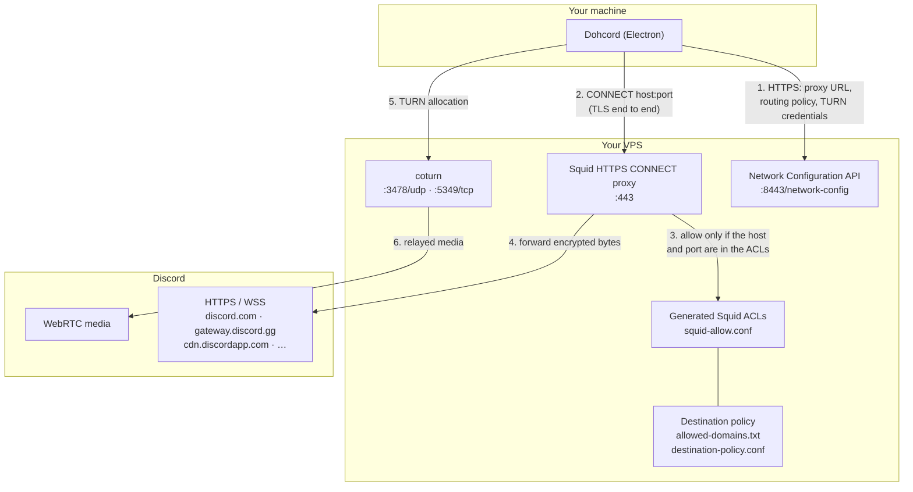

# Dohcord-relay

**A private HTTPS proxy and TURN relay for [Dohcord](https://github.com/Newipe/Dohcord), on your own server.**

Dohcord-relay gives Dohcord a way to reach Discord's HTTPS, WebSocket and voice
endpoints through a server you control, without a VPN and without decrypting
anything. It runs two well-known pieces of software, Squid and coturn, behind a
small HTTPS endpoint that tells the client exactly how to connect.

[](#requirements)
[](#quick-installation)
[](#architecture)

---

## Contents

- [About](#about) · [Features](#features) · [Quick installation](#quick-installation)
- [Architecture](#architecture) · [Requirements](#requirements) · [Configuration](#configuration)
- [Network Configuration API](#network-configuration-api) · [Domain policy](#domain-policy)
- [Management](#management) · [Updating](#updating) · [Troubleshooting](#troubleshooting)
- [Uninstalling](#uninstalling) · [Security](#security) · [Development](#development)
- [Documentation](#documentation)

---

## About

Dohcord is a Discord client. Discord's traffic has two halves: ordinary HTTPS
and WebSocket connections to a handful of domains, and WebRTC media for voice
and video. Dohcord-relay provides a server-side rendezvous for both:

- an **HTTPS CONNECT proxy** (Squid) that accepts encrypted connections and
  forwards them to a **short, server-enforced list of destinations**;
- a **TURN relay** (coturn) for voice and video when a direct connection between
  peers is not possible;
- a **Network Configuration API** on port 8443 that hands Dohcord the proxy
  address, the routing policy and short-lived TURN credentials in one document.

Nothing is intercepted or re-encrypted. Discord's TLS session runs end-to-end
between Dohcord and Discord; the proxy only sees host names and ports, and only
for destinations the relay has been told to allow.

> **Compatibility promise.** The client-facing contract is unchanged by this
> documentation and tooling work: same ports, same endpoints, same JSON, same
> proxy and TURN protocols. An existing Dohcord build keeps working; no client
> update is needed to use this version of the relay.

---

## Features

| | |
|---|---|
| **HTTPS CONNECT proxy** | Squid on TCP 443, CONNECT only, no TLS interception, certificate chain sent to clients. |
| **Selective routing** | Two plain-text policy files decide which hosts and ports may be reached. Everyone else gets `403`. |
| **Server-side enforcement** | The client is never trusted: limits, destination checks and resolved-address checks all happen on the server. |
| **TURN relay** | coturn on 3478/udp and 5349/tcp with REST credentials and a bounded relay range. |
| **Network Configuration API** | One HTTPS document (`/network-config`) with the proxy endpoint, routing rules and temporary credentials. |
| **Automated certificates** | certbot with a deploy hook and a systemd timer, including IP certificates for address-only installs. |
| **Management console** | `dohcord-relay-manager` for status, policy, certificates, updates, repair and uninstall. |
| **Idempotent installer** | Re-running it keeps your configuration, policy and certificates. |

---

## Quick installation

On a fresh Debian 12 or Ubuntu 22.04+ server, as a user with `sudo`:

```bash
bash <(curl -fsSL https://raw.githubusercontent.com/Newipe/Dohcord-relay/main/install.sh)
```

That single command:

1. checks the machine (distribution, architecture, internet access, busy ports);
2. downloads this repository's archive over HTTPS into a private temporary
   directory — the archive is extracted, never piped into a shell;
3. asks how clients should reach the server (a domain name, recommended, or the
   public IPv4 address), then shows every setting before changing anything;
4. installs Squid, coturn, a pinned certbot and the relay binary;
5. obtains a TLS certificate, opens the required firewall ports, installs the
   systemd services and validates the configuration;
6. runs the verification suite and prints the URLs to paste into Dohcord.

When it finishes you get the line to add in **Dohcord → Settings → Custom
Profile**:

```text
https://relay.example.com:8443/network-config
```

and a management console:

```bash
sudo dohcord-relay-manager
```

Requirements and options are in [docs/installation.md](docs/installation.md).
The installer needs root (it uses `sudo` itself when started as a normal user),
outbound HTTPS to github.com and your package mirror, and these inbound ports:
**80/tcp** (certificate validation), **443/tcp**, **8443/tcp**,
**3478/udp**, **5349/tcp**, **49152–65535/udp**.

> **Security note.** This command downloads and runs the installer from this
> repository. That is the same trust model as running any install script: you are
> trusting the repository's `main` branch. The bootstrap itself makes no other
> network requests beyond the archive and the packages the installer installs,
> never disables TLS verification, and prints what each step does. If you prefer
> to read before running, clone the repository and run
> `sudo bash deploy/install.sh`, which uses the files you can see.

---

## Architecture



The policy files are the only source of truth. Both the Squid authorization and
the `routing.domains` array in `/network-config` are generated from the same
parsed policy, so the client can never be told about a destination the proxy
would refuse — or the reverse.

```
allowed-domains.txt ─┐
                     ├─► validate ─► squid-allow.conf  (Squid enforcement)
destination-policy.conf ┘        └─► /network-config    (client routing)
```

---

## Requirements

| | |
|---|---|
| **Distribution** | Debian 12+ ; Ubuntu 22.04+ (tested on Ubuntu 24.04 and Debian 12) |
| **Architecture** | `amd64`, `arm64` — anything Debian/Ubuntu and coturn build for |
| **Init** | systemd |
| **Privileges** | root (or a user with `sudo`) |
| **Network** | outbound HTTPS; inbound TCP 80, 443, 8443, 5349 and UDP 3478, 49152–65535 |
| **Client** | Dohcord's Custom Profile feature; no relay-specific client build |

An IP-only install works without a domain, using a short-lived Let's Encrypt IP
certificate that the renewal timer keeps current. A domain install additionally
requires an A record pointing at the server before the installer runs.

---

## Configuration

Everything lives under `/etc/dohcord-relay`:

| File | Purpose |
|---|---|
| `config.env` | The API's own settings: proxy URL, TURN URLs, credential lifetime, listen address. |
| `allowed-domains.txt` | Which host names the proxy may reach. |
| `destination-policy.conf` | Which TCP ports each of those hosts may use. |
| `squid-allow.conf` | **Generated** Squid ACLs — do not edit. |
| `squid.conf` | Squid configuration, rendered by the installer. |
| `turnserver.conf` | coturn configuration, rendered by the installer. |
| `turn-secret` | Shared secret for TURN REST credentials (`0640`). |
| `tls/` | `fullchain.pem`, `privkey.pem`, and `squid.pem` for the proxy listener. |
| `policy.json` | Snapshot of the policy Squid is currently enforcing. |
| `install-info` | Version, mode and public endpoints, read by the management console. |

Full details, including every `config.env` key: [docs/configuration.md](docs/configuration.md).

---

## Network Configuration API

`GET https://<your relay>:8443/network-config` is the only endpoint Dohcord needs.

```json
{
  "schemaVersion": 1,
  "version": 1,
  "proxy": { "scheme": "https", "host": "relay.example.com", "port": 443 },
  "routing": {
    "domains": [
      { "host": "discord.com", "match": "suffix",
        "ports": [{ "from": 443, "to": 443 }] },
      { "host": "discord-attachments-uploads-prd.storage.googleapis.com",
        "match": "exact", "ports": [{ "from": 443, "to": 443 }] }
    ]
  },
  "httpsProxy": { "url": "https://relay.example.com:443", "allowedDestinations": [] },
  "rtcRelay": { "expiresAt": 1794600000, "iceServers": [] }
}
```

- `routing.domains` — hosts to send through the proxy, with `exact` or `suffix`
  matching and the permitted port ranges.
- `proxy` — where the proxy is (443). The **configuration** endpoint is 8443 and
  is not a proxy target.
- `httpsProxy` and `rtcRelay` — the original fields, unchanged for older clients.

The document is `no-store`, rate limited, and answers `503` rather than serving an
incomplete policy. Full schema and error behaviour:
[docs/network-config-api.md](docs/network-config-api.md).

---

## Domain policy

The allowlist is two plain text files, and the same workflow serves every change:

```bash
sudoedit /etc/dohcord-relay/allowed-domains.txt        # add: cdn.example.com
sudoedit /etc/dohcord-relay/destination-policy.conf    # add: cdn.example.com  443
sudo dohcord-relay -config /etc/dohcord-relay/config.env -policy-check
sudo dohcord-relay -config /etc/dohcord-relay/config.env -policy-apply
```

Or without touching files:

```bash
sudo dohcord-relay-manager        # Domain policy → Add a destination
```

`-policy-check` validates both files and the whole Squid configuration;
`-policy-apply` additionally writes the ACLs, records the applied snapshot and
reloads Squid. **If anything is invalid, nothing is applied** and the previous
policy stays in force — for the proxy and for the API alike.

A leading `=` makes an entry exact-host (no subdomains):

```text
=discord-attachments-uploads-prd.storage.googleapis.com
```

Format, matching rules and safety notes: [docs/domain-policy.md](docs/domain-policy.md).

---

## Management

```bash
sudo dohcord-relay-manager
```

```text
  ╭──────────────────────────────────────────────────────╮
  │                                                      │
  │                    Dohcord-relay                     │
  │                      Management                      │
  │                                                      │
  ├──────────────────────────────────────────────────────┤
  │                                                      │
  │  1. Dashboard          6. TLS certificates           │
  │  2. Services           7. Diagnostics                │
  │  3. Network            8. Update                     │
  │  4. Domain policy      9. Repair                     │
  │  5. Firewall           10. Uninstall                 │
  │                                                      │
  │  0. Exit                                             │
  ╰──────────────────────────────────────────────────────╯
```

Every menu entry is also a subcommand, for scripts and headless use:

| Command | What it does |
|---|---|
| `dohcord-relay-manager dashboard` | Services, certificate, endpoints, listeners, load, policy state |
| `dohcord-relay-manager network` | Addresses, files, policy validity, and the document clients receive |
| `dohcord-relay-manager services status` | The three relay units and the renewal timer |
| `dohcord-relay-manager services restart dohcord-relay-squid.service` | Restart one unit |
| `dohcord-relay-manager policy show` | Every destination with its match type and ports |
| `dohcord-relay-manager cert status` | Issuer, validity, days remaining, renewal timer |
| `dohcord-relay-manager diagnostics` | Health checks, optionally the full verification suite |
| `dohcord-relay-manager update` | Download, back up configuration, re-install, verify |
| `dohcord-relay-manager repair` | Fix permissions, directories, stopped units |
| `dohcord-relay-manager uninstall` | Remove the relay (see below) |

Prefer plain systemctl? Nothing depends on the console:

```bash
systemctl status  dohcord-relay-api dohcord-relay-squid dohcord-relay-coturn
systemctl restart dohcord-relay-squid
journalctl -u dohcord-relay-api -f
```

> The relay's proxy is its **own** unit, `dohcord-relay-squid.service`. The
> distribution's `squid.service` is a different service and is neither used nor
> touched.

---

## Updating

```bash
sudo dohcord-relay-manager        # Update
```

The updater backs up `/etc/dohcord-relay`, downloads the current `main`, shows
the installed and available versions, and runs the same installer with your
saved mode, host and address. Configuration, domain policy, certificates and
private keys are preserved — the installer never overwrites an existing
`config.env`, policy file or valid certificate. If the update fails, it offers to
restore the configuration backup.

Re-running the one-line installer does the same thing, and is always safe to
repeat.

---

## Troubleshooting

Start with the built-in checks:

```bash
sudo dohcord-relay-manager diagnostics
curl -sS https://relay.example.com:8443/network-config | python3 -m json.tool
```

| Symptom | First thing to check |
|---|---|
| Installer stops at ports | Something already listens on 80/443/8443/3478/5349 — `sudo dohcord-relay-manager dashboard` |
| Certificate issuance fails | Port 80 reachable, A record points here, no AAAA record without IPv6 |
| Let's Encrypt rate limit | The existing certificate is kept; wait for the stated reset. Do not retry in a loop |
| Dohcord cannot connect | `curl` the config URL; check `dohcord-relay-api` and the firewall |
| Proxy returns 403 | The host is not in the policy, or the port is not allowed for it |
| Voice fails, text works | TURN ports/security group, or coturn is down (`services status`) |
| Squid will not start | `dohcord-relay-manager policy check`, then `services validate` |

Detailed causes and commands: [docs/troubleshooting.md](docs/troubleshooting.md).

---

## Uninstalling

```bash
sudo bash uninstall.sh            # or: dohcord-relay-manager → Uninstall
```

It stops and removes the services, units, binaries and runtime directories, then
asks before deleting anything that is expensive to recreate.

```text
  Kept by default:  /etc/dohcord-relay (configuration, policy, certificates)
  --purge:          also removes that directory and the service user
  --purge-cert:     also deletes the Let's Encrypt certificate lineage
```

The squid and coturn packages and any firewall rules you opened are left in
place and reported at the end. Nothing is deleted without a typed confirmation.

---

## Security

- **No interception.** TLS runs end-to-end between Dohcord and Discord. There is
  no `ssl_bump`, no generated certificates, no plaintext.
- **Server-side authorization.** The destination policy is enforced by Squid from
  files on the server. A modified client cannot reach a host the relay has not
  authorized.
- **Resolved addresses are checked.** Allowlisted names that resolve to
  loopback, private, link-local, CGNAT, documentation or multicast addresses are
  refused after resolution, which closes DNS-rebinding paths.
- **Not an open proxy.** CONNECT only, no IP literals, per-client connection and
  rate limits, global descriptor limits, and a final `deny all`.
- **Credentials stay short-lived.** TURN credentials are HMACs over a server-side
  secret with an expiry; the secret never leaves the server and is never logged.

What it is not: not a VPN, not anonymity, not a way around network policy where
the relay's own address is blocked. The threat model and its limits are in
[docs/security.md](docs/security.md).

---

## Development

```bash
go test ./...                                  # policy, credentials, endpoint
gofmt -l . && go vet ./...
bash -n install.sh uninstall.sh deploy/*.sh    # shell syntax
sudo bash deploy/verify.sh                     # end-to-end checks on a live relay
```

`deploy/verify.sh` verifies the services, listeners, certificate chain, the
generated ACLs against the policy files, real CONNECT allow/deny behaviour, the
API document, TURN credentials and media, and renewal. It is read-only apart from
a certbot dry run (skip it with `DOHCORD_RELAY_SKIP_RENEW=1`).

---

## Documentation

| Document | Contents |
|---|---|
| [Installation](docs/installation.md) | Requirements, one-line install, all installer options, non-interactive use, what the installer does |
| [Configuration](docs/configuration.md) | `config.env`, Squid, coturn, file locations and permissions, tuning |
| [Network Configuration API](docs/network-config-api.md) | Schema, fields, matching, errors, caching, custom profiles |
| [Domain policy](docs/domain-policy.md) | File format, exact vs suffix, ports, validation and apply workflow |
| [Troubleshooting](docs/troubleshooting.md) | Symptom → cause → command |
| [Security](docs/security.md) | Threat model, protections, non-goals |

No other language variants are maintained.

## License

No license file is currently included in this repository, so all rights are
reserved by the author. If you intend to reuse the code, ask first.
